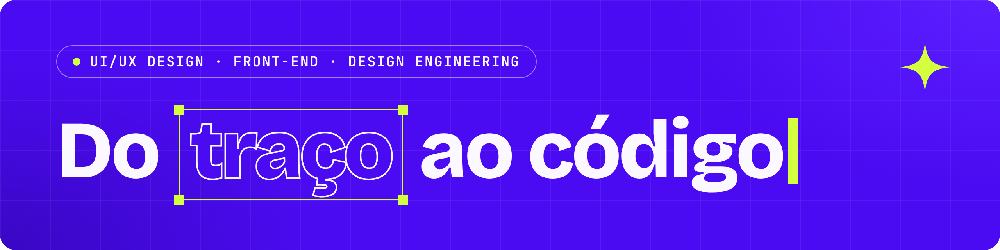

### Olá, eu sou o Gabriel 👋

Estudante de Ciência da Computação na UVA, no Rio de Janeiro. Trabalho no ponto em que o design vira código: desenho interfaces no Figma e construo o resultado no navegador, com cuidado com acessibilidade e com os estados da interface.

Busco estágio em **UI/UX Design e Front-End**, com o objetivo de atuar em **Design Engineering**.

  
  
  

### Projetos em destaque

<table>
  <tr>
    <td width="33%" valign="top">
      
       <b>Buscar Animes</b>
       Busca, listas e sorteio de animes com a API do AniList. React, TypeScript, Tailwind e testes.
       <a href="https://buscar-animes.vercel.app/">Demo</a> · <a href="https://github.com/gabrielrizzoo/Buscar-Animes">Código</a>
    </td>
    <td width="33%" valign="top">
      
       <b>Bocchi The Rock!</b>
       Redesign de UI/UX inspirado em flyers de show, com tokens CSS e componentes acessíveis.
       <a href="https://projetositebocchi.vercel.app/">Demo</a> · <a href="https://github.com/gabrielrizzoo/ProjetoSiteBocchi">Código</a>
    </td>
    <td width="33%" valign="top">
      
       <b>Incentivart</b>
       Freelance em dupla: UI/UX e parte do front-end do site institucional e do Blog.
       <a href="https://gabrielrizzo.vercel.app/projetos/incentivart.html">Estudo de caso</a> · <a href="https://incentivart.com.br/">Site</a>
    </td>
  </tr>
</table>

### Ferramentas

  
  
  
  
  
  
  
  
  

<b>Do traço ao código.</b>

